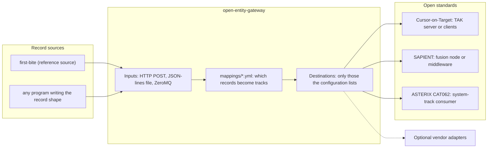

# open-entity-gateway

**Turns decoded messages into tracks and publishes them over open interface standards: Cursor-on-Target, SAPIENT (BSI Flex 335 v2.0) and ASTERIX category 062. Optional adapters for vendor interfaces are separate packages.**

The gateway reads *records*. A record is a JSON or CBOR object that holds one message's decoded fields under `message`, with `subsystem`, `message_type` and `timestamp` saying what the message is and when it was captured. A mapping file says which records become tracks and which fields fill them. [first-bite](https://github.com/USAREUR-AF/first-bite) writes records in this shape and is the reference source; any program that writes the same shape can feed the gateway. How the gateway is meant to serve the other goat repositories, as the one way tracks leave the fabric for systems outside it, is in [docs/design/track-egress.md](docs/design/track-egress.md) (designed, not built).



The gateway sends only to the destinations its configuration lists. A configuration that lists none stops the gateway at start-up. A record that cannot fill its mapping is refused, the log names the field, and no destination receives anything for it.

## Supported interfaces

Status words: **built** (the code exists and its unit tests pass), **measured** (a command ran against the named test target and produced the stated result), **designed, not built** (decided, no code), **not built** (nothing exists).

### Open standards

| Interface | Owner | Country | How it is published | Licence or terms | Status | Test target | Source, date read |
|---|---|---|---|---|---|---|---|
| Cursor-on-Target 2.0, XML over UDP (unicast, multicast) and TCP, TLS optional | MITRE (schemas); TAK Product Center (framing) | US | public-release XSDs and framing notes in a public repository | MITRE: "Approved for Public Release; Distribution Unlimited"; repository GPL-3.0; schemas fetched at test time, not copied | built; measured | OpenTAKServer (container), MITRE public-release XSDs | [atak-civ takcot/mitre, takproto](https://github.com/TAK-Product-Center/atak-civ), 2026-11-15 |
| SAPIENT, BSI Flex 335 v2.0, edge node (registration, status, detection reports) | UK MOD / Dstl; BSI (document) | UK | proto files in a public repository; standard from BSI | protos Apache-2.0 (Crown copyright), fetched at a pinned commit; document BSI copyright, linked not copied | built; measured | Dstl Apex SAPIENT middleware 4.2.0 (container) | [dstl/SAPIENT-Proto-Files](https://github.com/dstl/SAPIENT-Proto-Files), [BSI Flex 335 v2.0](https://knowledge.bsigroup.com/products/bsi-flex-335-v2-0-2023-sapient-network-of-autonomous-sensors-and-effectors-interface-control-document-specification-specification), 2026-11-15 |
| ASTERIX category 062, system track data | EUROCONTROL | intergovernmental (Belgium) | specification, free download | EUROCONTROL publication, linked not copied | built; measured | asterix4py 1.0.6 decoder (MIT), round trip field by field | [CAT062 edition 1.21](https://www.eurocontrol.int/publication/cat062-eurocontrol-specification-surveillance-data-exchange-asterix-part-9-category-062), 2026-11-15 |
| NATO ISR tracking standard, STANAG 4676 Ed. 2 (AEDP-12) | NATO | NATO | documents in the NATO Standardization Office public database; XML schemas through national representatives | NATO copyright | not built | none | [NSO public database](https://nso.nato.int/nso/nsdd/main/standards), 2026-11-15 |
| OGC SensorThings API 1.1 and 2.0 | Open Geospatial Consortium | international | public specification | OGC Document License Agreement | not built | FROST-Server (LGPL-3.0) would be the target | [OGC SensorThings](https://www.ogc.org/standards/sensorthings/), 2026-11-15 |
| OARIS 2.0, Open Architecture Radar Interface Standard: radar to combat management system, including track reporting | Object Management Group (contributors include Thales, BAE Systems and Atlas Elektronik) | international | formal specification (formal/23-09-01) and machine-readable files on omg.org | OMG specification terms (not yet read) | not built | none | [OMG OARIS](https://www.omg.org/spec/OARIS/2.0), 2026-11-18 |
| C2SIM, SISO-STD-019-2020 / STANAG 4856 Ed. 1: command and control to simulation (orders, reports) | SISO; NATO | international; NATO | SISO standard; NATO STANAG approved 2023; an open-source reference server exists | not yet read | not built | the open-source C2SIM server would be the target | [C2SIM in a nutshell (TNO)](https://tno-mst.github.io/c2sim-server/c2sim-in-nutshell), [STO-EN-MSG-211](https://www.sto.nato.int/publications/STO%20Educational%20Notes/STO-EN-MSG-211/EN-MSG-211-2.3.pdf), 2026-11-18 |
| NATO Generic Vehicle Architecture, STANAG 4754 Ed. 3 / AEP-4754 Vol. V Land Data Model (DDS) | NATO, from UK GVA | NATO | STANAG sold through standards retailers; whether the data model files can be obtained freely is not confirmed | NATO copyright | not built | none | [STANAG 4754 Ed. 3](https://shop.standards.ie/en-ie/standards/stanag-4754-ed-3-2024-1318066_saig_nato_nato_3492169), [AEP-4754 Vol. V](https://standards.globalspec.com/std/14590051/aep-4754-vol-v), 2026-11-18 |

### Vendor interfaces (optional adapters, alphabetical by vendor)

| Interface | Owner | Country | How it is published | Licence or terms | Status | Test target | Source, date read |
|---|---|---|---|---|---|---|---|
| AARTOS drone-tracking JSON format | Aaronia AG | Germany | PDF on the vendor's forum | none stated | not built | none | [format description](https://v6-forum.aaronia.de/wp-content/uploads/asgarosforum/30/Drone-Tracking-JSON-Format-10.pdf), 2026-11-15 |
| Lattice SDK for Python, `entities.publish_entity` | Anduril Industries | US | public repository and PyPI package `anduril-lattice-sdk` | Anduril Lattice SDK License Agreement (not open source); installing or using the SDK accepts it; this project distributes no SDK file | built; not run against a Lattice environment | SDK with its HTTP transport replaced by a local stub | [lattice-sdk-python](https://github.com/anduril/lattice-sdk-python), 2026-11-15 |
| Auterion SDK | Auterion | US, Switzerland | public documentation | not found | not built | none | [Auterion SDK](https://docs.auterion.com/app-development/auterion-sdk), 2026-11-15 |
| INTeACT SDK | BAE Systems | UK | product page | not read (the page refused automated reading) | not built | none | [INTeACT SDK](https://www.baesystems.com/en-uk/product/inteact-software-development-kit), 2026-11-15 |
| Foundry and Gotham platform SDKs; Ontology SDK (generated per customer ontology) | Palantir Technologies | US | public repositories; OSDK generated in each customer's Developer Console | platform SDKs and osdk-ts Apache-2.0 | designed, not built | none | [foundry-platform-python](https://github.com/palantir/foundry-platform-python), [osdk-ts](https://github.com/palantir/osdk-ts), [Defense OSDK](https://palantir.com/docs/defense-osdk/api/missionPlanning/overview/about/), 2026-11-15 |
| Expeditionary C2 Node SDK (`picogrid-ecn-client`), MQTT v5 | Picogrid | US | public repository and PyPI package | MPL-2.0 | built; measured | the SDK's own offline mock (`MockECN`) | [ecn-sdk-python](https://github.com/picogrid/ecn-sdk-python), [docs](https://docs.picogrid.com/ecn-sdk/), 2026-11-15 |
| Legion REST API v3, OAuth 2.0 | Picogrid | US | public documentation; OpenAPI 3.1 document downloadable without login | the OpenAPI document states no licence or terms; Picogrid's commercial terms govern customers | designed, not built | none | [Legion docs](https://docs.picogrid.com/legion/), [commercial terms](https://picogrid.com/legal/commercial-license-terms.pdf), 2026-11-15 |
| TacticalAPI, gRPC (`Situation`, `BlueForceTracking`, `OwnPose`) | Rheinmetall | Germany | public repository with protos and a C# test client | EPL-2.0 | designed, not built | none | [Rheinmetall/tacticalapi](https://github.com/Rheinmetall/tacticalapi), 2026-11-15 |
| Skydio Cloud API (REST, OpenAPI) | Skydio | US | public documentation | API terms: internal business use; distribution needs Skydio's written approval | not built | none | [Skydio API docs](https://apidocs.skydio.com/reference/introduction), [API terms](https://www.skydio.com/legal/api-terms-of-service), 2026-11-15 |

The vendors named here are the integrations built or considered so far. Their presence is not an endorsement or a preference. The list is expected to grow, and integrations for other vendors are welcome.

What each built adapter sends and how it was tested: [docs/adapters/](docs/adapters/). What a designed or not-built vendor adapter would need: [docs/vendors.md](docs/vendors.md). Controlled military data links and message standards are out of scope: Link 16, JREAP, VMF, ADatP-3, JC3IEDM.

## Neutrality

This project implements publicly available interface standards. Named products and companies appear only to state which published standard or interface an adapter speaks, as described by their owners at the cited sources. No endorsement by or of any company, product or government is implied. All trademarks belong to their owners. Optional vendor adapters require the user to obtain and accept that vendor's licence; this project distributes no vendor software.

## Run it

Python 3.11 or later.

```bash
python -m venv .venv && . .venv/bin/activate
pip install --require-hashes -r requirements/runtime.txt
pip install --no-deps -e .
python tools/fetch-sapient-proto.py      # only for the SAPIENT adapter; needs requirements/tools.txt
```

Print what each adapter would send for first-bite's example records, sending nothing:

```bash
open-entity-gateway print --mapping mappings --adapter cot examples/records/weather-station.records.jsonl
```

```xml
<event version="2.0" uid="KX7" type="a-f-G" time="2025-06-15T15:06:43Z" start="2025-06-15T15:06:43Z" stale="2025-06-15T15:16:43Z" how="m-g" access="Undefined"><point lat="64.8378" lon="-147.7164" hae="136.5" ce="9999999" le="9999999"/><detail><contact callsign="KX7"/></detail></event>
```

To send, write a configuration that names each destination ([examples/gateway.yml](examples/gateway.yml)), check it, then take records from first-bite's `rest` sink or from a file:

```bash
open-entity-gateway check  --config gateway.yml
open-entity-gateway serve  --config gateway.yml --listen 127.0.0.1:5001
open-entity-gateway replay --config gateway.yml examples/records/weather-station.records.jsonl --shift-to-now
```

`serve` answers each POST: `204` the record was queued for every destination or no mapping matches it; `422` a mapping matches and the record cannot fill it; `400`, `404`, `411`, `413`, `415` for a request that is not a record posted to the path. It speaks plain HTTP and binds loopback by default. The `zmq` command reads first-bite's ZeroMQ publisher socket instead (`pip install pyzmq`).

## Mapping files

One YAML file per message. The keys `uid`, `type`, `position`, `stale_minutes` and `form` are first-bite's `cot:` mapping keys and mean the same, so the block a first-bite subscriber carries under `cot:` is a mapping file's core unchanged. [docs/mapping.md](docs/mapping.md) gives every key, the value forms, and where the gateway differs from first-bite.

```yaml
match: { subsystem: WX, message_type: Position, dictionary: weather-station }
uid: [station_id]
type: { value: "a-f-G" }
position: { geodetic: [latitude, longitude, altitude] }
stale_minutes: 10
time: capture              # default: the record's capture time
name: { field: station_id }
```

## Tests

```bash
pip install --require-hashes -r requirements/runtime.txt -r requirements/dev.txt -r requirements/tools.txt
python tools/fetch-cot-xsd.py && python tools/fetch-sapient-proto.py
python -m pytest
```

The unit tests need no server and no vendor SDK. `tests/e2e/run-on-build-host.sh` starts OpenTAKServer and Dstl's Apex in containers and runs `tests/e2e/` against them. The vendor packages' tests are under `vendors/*/tests/`; each skips unless its vendor SDK is installed, and CI installs none.

## Repository

| Path | What |
|---|---|
| `src/open_entity_gateway/` | the core (inputs, mapping, gateway, adapter interface) and the open-standard adapters |
| `vendors/lattice/`, `vendors/picogrid-ecn/` | optional vendor adapters, each its own package |
| `mappings/` | example mapping files, for first-bite's weather-station dictionary and hello-galaxy-first-bite's harbour-buoy dictionary |
| `examples/` | example records and an example configuration |
| `tools/` | pinned fetchers for the SAPIENT protos and the CoT schemas; the cotify test-vector generator |
| `tests/` | unit tests; `tests/e2e/` against servers in containers; `tests/vectors/` events first-bite wrote |
| `docs/` | mapping, adapters, vendors, handling rules, relationship to first-bite and goat, the track-egress design |

## Licence

Apache License 2.0; see [LICENSE](LICENSE), [NOTICE](NOTICE) and [INTENT.md](INTENT.md). Third-party material the gateway fetches or depends on keeps its own licence; [NOTICE](NOTICE) lists it. Part of [goat](https://github.com/USAREUR-AF/goatcore): see [docs/first-bite-and-goat.md](docs/first-bite-and-goat.md).
