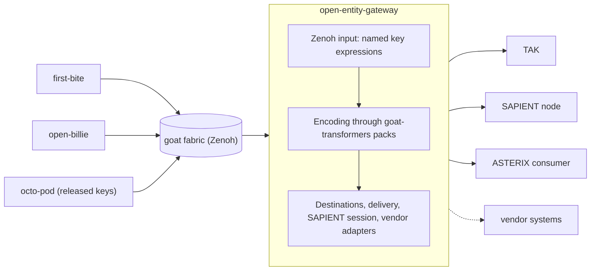

# Track egress: one way out of the fabric

**Status: designed; steps 1 and 2 built.** The gateway accepts Canonical Track v2 (step 1) and reads the fabric on named key expressions (step 2); the other steps are not built. Each step below is its own pull request in the repository named, and its tracking issue is linked at the end.

Five goat repositories turn data into tracks or move tracks between systems, and three of them encode Cursor-on-Target, SAPIENT and ASTERIX each in their own code. This design makes the goat fabric (Zenoh) the one place tracks meet, and this gateway the one way they leave the fabric for systems that are not on it. Each format is encoded in one place, goat-transformers, and checked by its conformance vectors.

## Where each repository stands

| Repository | How its data reaches other systems today | Track encoders it holds |
|---|---|---|
| [first-bite](https://github.com/USAREUR-AF/first-bite) | One record per decoded message on a ZeroMQ socket; sinks to Zenoh, HTTP, object storage and files; CoT to TAK through its `cot` transform | CoT |
| [open-billie](https://github.com/USAREUR-AF/open-billie) | A sensor kit maps fields into Billie's canonical record; the shared Rust translator encodes it and publishes on a local Zenoh route, bridged to the fabric over mTLS | CoT, ASTERIX CAT062, SAPIENT |
| [octo-pod](https://github.com/USAREUR-AF/octo-pod) | Takes in sensor feeds, records and audits them, and releases only the declared keys onto the fabric; an egress arm sends released data to a receiver or a partner's Zenoh router | none |
| [goat-transformers](https://github.com/USAREUR-AF/goat-transformers) | A library and command: any supported format to any other, each format a data pack, seven engines (Python among them) that must agree byte for byte | packs `cot-xml`, `cot-protobuf`, `sapient`, `sapient-v1`, `asterix-cat062`, `canonical-track-v2` |
| open-entity-gateway (this repository) | Reads records over HTTP, from a file or from first-bite's ZeroMQ socket; sends to the destinations a configuration lists | CoT, SAPIENT, ASTERIX CAT062, plus vendor adapters |

## The design

1. **Tracks on the fabric use one shape.** A producer that publishes tracks publishes them as Canonical Track v2 (`billie.dev/track-v2`, open-billie's `schemas/canonical-track-v2.schema.json`, already the goat-transformers pack `canonical-track-v2`). A producer that publishes records instead, as first-bite does, keeps doing so, and the gateway's mapping files turn those records into tracks as they do today.
2. **The gateway reads the fabric.** A Zenoh input subscribes to key expressions its configuration names. It never subscribes to the whole keyspace, which goat reserves for a named grant. What the gateway may read is decided by the fabric's access control, never by the gateway.
3. **Each format is encoded in one place.** The gateway's CoT, SAPIENT and ASTERIX CAT062 output comes from the goat-transformers packs through its Python engine. The gateway keeps what only it does: per-destination configuration, transport and delivery, the SAPIENT registration and status session, the presence event, and the vendor adapters.
4. **The gateway is the way out for systems off the fabric.** octo-pod's release gate stays where it is; a gateway configured beside a pod subscribes only to the keys the pod released. open-billie and first-bite keep publishing to the fabric, and a receiver that is not on the fabric is served by a gateway.
5. **The gateway's rules do not change.** It sends only to destinations a configuration lists, and a track that cannot fill a destination's interface is refused by field name, with nothing sent.

## Order of work

Each step is one pull request that can be reverted on its own.

| Step | Repository | Change | Done when |
|---|---|---|---|
| 1 | open-entity-gateway | Accept Canonical Track v2 as input beside records (file and HTTP) | the example tracks round-trip to all three standards |
| 2 | open-entity-gateway | Zenoh input on named key expressions | a test router delivers to every destination type |
| 3 | goat-transformers | Add the gateway's CoT, SAPIENT and CAT062 test vectors to the packs | all seven engines pass them |
| 4 | open-entity-gateway | Encode through goat-transformers, then retire the gateway's own encoders one release later | the gateway's tests pass unchanged with the packs |
| 5 | octo-pod | A documented setup of a gateway subscribed to released keys | a pod releases a key and a TAK receiver gets the track |
| 6 | open-billie, first-bite | Point receivers that are not on the fabric to the gateway | the docs say so; first-bite's CoT sink stays for the CoT-only case |

## Open questions

- Whether open-billie keeps publishing standard-format renderings onto the fabric besides Canonical Track v2. That is the open-billie maintainers' decision.
- Whether first-bite should also publish Canonical Track v2 for the dictionaries that carry positions, or leave that to gateway mappings.

## Tracking

| Step | Issue |
|---|---|
| 1 | [open-entity-gateway#6](https://github.com/USAREUR-AF/open-entity-gateway/issues/6) |
| 2 | [open-entity-gateway#7](https://github.com/USAREUR-AF/open-entity-gateway/issues/7) |
| 3 | [goat-transformers#14](https://github.com/USAREUR-AF/goat-transformers/issues/14) |
| 4 | [open-entity-gateway#8](https://github.com/USAREUR-AF/open-entity-gateway/issues/8) |
| 5 | [octo-pod#34](https://github.com/USAREUR-AF/octo-pod/issues/34) |
| 6 | [open-billie#29](https://github.com/USAREUR-AF/open-billie/issues/29), [first-bite#73](https://github.com/USAREUR-AF/first-bite/issues/73) |

OARIS and C2SIM as goat-transformers packs: [goat-transformers#15](https://github.com/USAREUR-AF/goat-transformers/issues/15).
